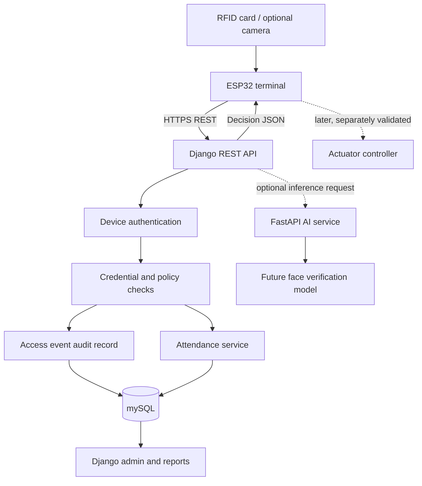

# AI-Powered Smart Access Control and Attendance System

A modular IoT starter project combining RFID identification, an optional camera/AI verification service, access policy, attendance records, and a Django web platform. The reference architecture uses an ESP32 access terminal, Django REST Framework, FastAPI, PostgreSQL, and Docker Compose.

> **Note:** This is a starter repository, not a production-ready biometric access system. The Django data model, RFID scan API, device-token authentication pattern, FastAPI interface, ESP32 reference sketch, tests, and deployment scaffolding are provided. 

## Contents
- [AI-Powered Smart Access Control and Attendance System](#ai-powered-smart-access-control-and-attendance-system)
  - [Contents](#contents)
  - [1. Objectives](#1-objectives)
  - [2. Features and status](#2-features-and-status)
  - [3. Architecture](#3-architecture)
    - [Service boundaries](#service-boundaries)
  - [4. Technology stack](#4-technology-stack)
  - [5. Repository structure](#5-repository-structure)
  - [6. Access workflow](#6-access-workflow)
  - [7. Data model](#7-data-model)
  - [8. REST API](#8-rest-api)
    - [`GET /health/`](#get-health)
    - [`POST /access/scan/`](#post-accessscan)
  - [9. Quick start with Docker](#9-quick-start-with-docker)
  - [10. Run locally](#10-run-locally)
  - [11. ESP32 setup](#11-esp32-setup)
  - [12. Camera and AI implementation](#12-camera-and-ai-implementation)
  - [13. Testing](#13-testing)
  - [14. Security, privacy and safety](#14-security-privacy-and-safety)
  - [15. Hardware bill of materials](#15-hardware-bill-of-materials)
  - [16. Roadmap](#16-roadmap)
  - [17. Troubleshooting](#17-troubleshooting)
  - [18. Contributing and license](#18-contributing-and-license)
    - [Project status](#project-status)
  
## 1. Objectives

- Register people, RFID credentials, access terminals, access events and attendance.
- Authenticate each registered terminal before processing a scan.
- Evaluate credential validity on the server and record grants and denials.
- Provide a separate FastAPI boundary for future computer-vision/ML inference.
- Integrate an ESP32 RFID reader over a REST API.
- Provide repeatable local deployment, automated tests and implementation documentation.

## 2. Features and status

| Feature | Status in this starter |
|---|---|
| Django REST API and relational models | Included |
| Device ID + hashed device-token check | Included |
| RFID scan decision and event log | Included |
| Entry/exit attendance event record | Basic implementation included |
| Django admin management interface | Included |
| FastAPI health and face-verification interface | Placeholder interface only |
| ESP32 + RC522 scan client | Reference sketch included |
| Real face recognition/liveness | Not implemented |
| Physical lock/relay actuation | Intentionally disabled |
| Production TLS, replay defence, device provisioning UI | Must be completed before deployment |

## 3. Architecture



### Service boundaries
- **ESP32:** reads RFID, connects to Wi-Fi and submits scan events. Future work adds camera, door-position sensor, buzzer and actuator control.
- **Django/DRF:** authoritative source for people, cards, devices, access decisions, audit events and attendance.
- **FastAPI:** isolated ML inference interface; it must not independently authorize access.
- **PostgreSQL:** persistent relational store in Docker Compose. SQLite is used for simple local runs without PostgreSQL settings.
- **Docker Compose:** repeatable development environment.

## 4. Technology stack

- Python 3.12; Django 5.1; Django REST Framework
- FastAPI and Uvicorn
- PostgreSQL 16; SQLite fallback for local development
- Docker and Docker Compose
- ESP32 Arduino framework with MFRC522/RC522 library; MicroPython can be substituted where library support permits
- Potential AI extensions: OpenCV, scikit-learn or PyTorch
- Django test framework; pytest can be added for AI-service tests

## 5. Repository structure

```text
ai-powered-smart-access-control/
├── README.md
├── .env.example
├── .gitignore
├── Dockerfile
├── docker-compose.yml
├── requirements.txt
├── manage.py
├── config/                 # Django settings and URL configuration
├── access_control/         # Models, serializers, API, services and tests
├── ai_service/             # FastAPI inference-service boundary
├── firmware/esp32_rfid_client/
│   └── esp32_rfid_client.ino
└── docs/
    ├── ARCHITECTURE.md
    ├── API.md
    ├── HARDWARE.md
    ├── SECURITY.md
    └── IMPLEMENTATION_ROADMAP.md
```

## 6. Access workflow

1. A person presents an RFID card.
2. ESP32 sends the normalized card UID, device ID and event type to Django.
3. Django authenticates the device using a per-device secret whose SHA-256 hash is stored server-side.
4. Django checks whether the credential and person are active and within their validity period.
5. The server writes an `AccessEvent` with the decision and reason.
6. If the scan is an allowed ENTRY/EXIT event, a basic attendance record is written.
7. The device receives a JSON response. The starter never operates a physical relay.

**Important:** RFID UIDs can be cloned on some card technologies. A UID is an identifier, not a cryptographic authentication factor. Production systems should consider secure cards, challenge-response where supported, a second factor, device request signing, and a threat model.

## 7. Data model

| Model | Purpose |
|---|---|
| `Person` | Staff, student or visitor profile |
| `RFIDCredential` | UID associated with a person, activation and validity dates |
| `AccessDevice` | Registered terminal, token hash, location and active state |
| `AccessEvent` | Timestamped granted/denied scan with reason and metadata |
| `AttendanceRecord` | Entry/exit attendance record linked to an access event |

The basic attendance rule is deliberately simple. Define duplicate-tap windows, shift schedules, overnight shifts, time zones, entry/exit semantics and correction workflows before real use.

## 8. REST API

Base path: `/api/v1/`

### `GET /health/`
Returns service status.

### `POST /access/scan/`
Required headers:

```text
X-Device-ID: lab-door-01
X-Device-Token: <provisioned-secret>
Content-Type: application/json
```

Example request:

```json
{
  "device_id": "lab-door-01",
  "card_uid": "A1B2C3D4",
  "event_type": "ENTRY",
  "request_id": "optional-request-id"
}
```

Example response:

```json
{
  "event_id": 42,
  "decision": "GRANTED",
  "reason": "Valid RFID credential; biometric verification not required by baseline policy",
  "attendance_recorded": true,
  "relay_authorized": false,
  "note": "Physical actuation is disabled in this starter implementation."
}
```

- `200`: scan evaluated; inspect `decision` for grant/denial.
- `400`: invalid payload.
- `401`: missing or invalid device credentials.
- `429`: throttled request where throttling is configured.

See [docs/API.md](docs/API.md) for details and hardening backlog.

## 9. Quick start with Docker

Prerequisites: Git, Docker Engine and Docker Compose.

```bash
git clone https://github.com/YOUR_USERNAME/ai-powered-smart-access-control.git
cd ai-powered-smart-access-control
cp .env.example .env
# Edit .env and replace all development secrets.
docker compose up --build -d
docker compose exec web python manage.py makemigrations access_control
docker compose exec web python manage.py migrate
docker compose exec web python manage.py createsuperuser
```

Open:
- Django admin: `http://localhost:8000/admin/`
- API health: `http://localhost:8000/api/v1/health/`
- FastAPI docs: `http://localhost:8001/docs`

In Django admin, create a Person, an RFIDCredential, and an AccessDevice. To generate a test token and its hash locally:

```bash
python -c "import secrets,hashlib; t=secrets.token_urlsafe(32); print('TOKEN=',t); print('SHA256=',hashlib.sha256(t.encode()).hexdigest())"
```

Put the raw token only in the device's protected configuration and put the SHA-256 digest in `AccessDevice.token_hash`. Do not commit either value. This repository's default Compose settings are for local development, not production.

## 10. Run locally

```bash
python -m venv .venv
# Windows: .venv\Scripts\activate
# Linux/macOS: source .venv/bin/activate
pip install -r requirements.txt
cp .env.example .env
python manage.py makemigrations access_control
python manage.py migrate
python manage.py createsuperuser
python manage.py runserver
```

In another terminal:

```bash
cd ai_service
pip install -r requirements.txt
uvicorn main:app --host 127.0.0.1 --port 8001 --reload
```

## 11. ESP32 setup

Open `firmware/esp32_rfid_client/esp32_rfid_client.ino` in Arduino IDE, install the ESP32 board package and a compatible MFRC522 library. Configure Wi-Fi, API URL, device ID and token for your test environment. The sample uses plain HTTP for isolated lab testing only; use HTTPS with certificate validation in any deployed network. Do not add relay/servo actuation until its command protocol, timeout, watchdog, door sensor and emergency egress behaviour have been separately implemented and tested.

## 12. Camera and AI implementation

The FastAPI endpoint is a **non-working placeholder** and always returns `verified: false`. To implement face verification:

1. Choose a supported camera and define capture quality/lighting requirements.
2. Establish notice, consent or another lawful basis and a retention/deletion policy.
3. Implement face detection and secure enrolment of biometric templates.
4. Select and evaluate a model for verification; do not treat face detection as identity verification.
5. Add liveness/presentation-attack controls appropriate to the threat model.
6. Evaluate false-accept and false-reject rates on representative validation data.
7. Return a structured result to Django; Django combines it with the card and access policy.
8. Avoid storing raw images unless necessary and properly protected.

Face verification involves biometric data. Before using real people, review applicable Nigerian data-protection obligations, access controls, security, retention, alternatives and consent/legal basis. A model score alone is not authorization.

## 13. Testing

```bash
python manage.py test
```

Additional tests recommended before deployment:
- unknown, expired, revoked and disabled credentials;
- unknown/disabled devices and wrong tokens;
- duplicate scans and attendance idempotency;
- AI outage, API timeout and malformed/oversized image;
- replay attempts, rate limiting and concurrent scans;
- door sensor/actuator failure, network loss and emergency release;
- false-accept/false-reject metrics and inference latency;
- backup restoration and audit-log retention.

## 14. Security, privacy and safety

- Use HTTPS with certificate validation and unique high-entropy device secrets.
- Store token hashes, rotate/revoke tokens and never log secrets.
- Add timestamp/nonce signing or mutual TLS to reduce replay risk.
- Rate-limit APIs and validate request/image sizes.
- Set `DEBUG=False`, use a strong Django secret, restrict admin and patch dependencies.
- Encrypt backups and test recovery.
- Minimize biometric collection and retention; protect templates and restrict access.
- Design emergency egress and physical safety to meet relevant building/fire requirements.
- Keep physical actuation disabled until a safety-reviewed implementation is complete.

## 15. Hardware bill of materials

| Item | Purpose / note |
|---|---|
| ESP32 board | Wi-Fi edge controller; check pin and camera support |
| MFRC522/RC522 reader | RFID scan; verify voltage compatibility |
| RFID test cards/tags | Use non-sensitive test credentials |
| Camera or IP camera | Image capture; a server-side camera may be easier than ESP32-CAM for inference |
| Low-voltage relay/servo demonstrator | Actuator prototype; not connected in starter firmware |
| Door/reed switch | Door-position feedback |
| Buzzer and LEDs | Local status feedback |
| Regulated power supply/enclosure | Stable power and physical protection |

Never drive a motor or lock directly from an ESP32 GPIO. Use an appropriately rated driver, power supply and isolation. Prototype with low voltage and obtain a safety review before any real door installation.

## 16. Roadmap

- [ ] Run Docker Compose and apply migrations.
- [ ] Register test person/card/device and pass API tests.
- [ ] Wire ESP32/RC522 and validate scans.
- [ ] Add HTTPS, signed requests/replay defence and provisioning workflow.
- [ ] Define shift and duplicate-attendance policies.
- [ ] Implement consented biometric enrolment, verification and liveness controls.
- [ ] Evaluate model accuracy and latency.
- [ ] Implement a separately authenticated actuator protocol with door sensor and fail-safe handling.
- [ ] Add custom dashboard, exports, monitoring, backups and CI/CD.
- [ ] Complete security, privacy and physical safety reviews.
